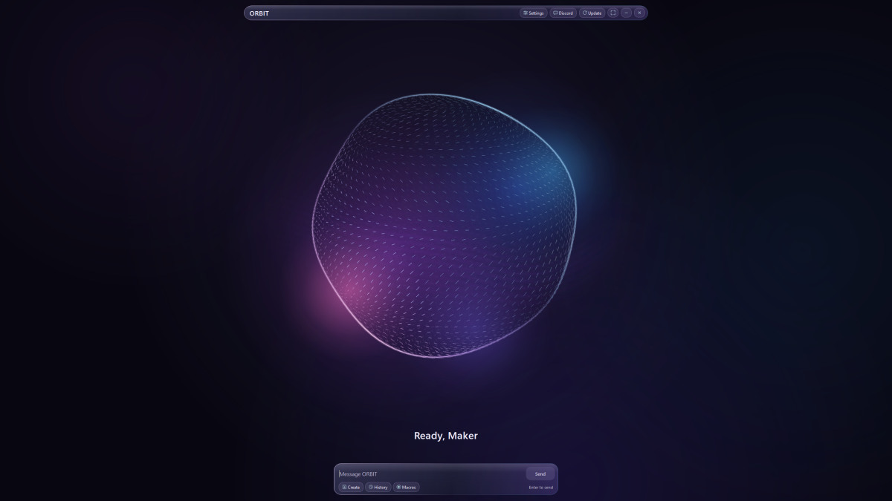

# ORBIT Desktop

**A voice-first AI assistant for Windows 11.** Type a request and hear ORBIT’s reply in a British voice. The orb animates as ORBIT thinks, speaks and runs approved Windows actions.

Created by [Liltaz6xx](https://github.com/Liltaz6xx). ORBIT calls the operator of each installation **Maker**.

## Install or update on Windows 11

1. Download the **Windows x64 Setup EXE** and its SHA-256 checksum. The installer is unsigned, so Windows SmartScreen may display a warning. [GitHub Releases](https://github.com/Liltaz6xx/orbit-desktop/releases)
2. Run Setup. It installs for your Windows account in %LOCALAPPDATA%\Programs\ORBIT Desktop and sets up Python, Ollama, Qwen2.5 1.5B, and the Kokoro voice. A fresh setup needs internet and downloads about 3 GB. Setup reuses existing dependencies and verified voice files. [Ollama for Windows](https://docs.ollama.com/windows) · [Default model](https://ollama.com/library/qwen2.5:1.5b)
3. Open **ORBIT Desktop** from the Start menu or the optional desktop shortcut, which is checked on a fresh install. Press **Enter** to send, **Esc** to stop, or **Read reply** to open the latest answer.

For updates, choose **Update** in the installed app or run the newer Setup EXE. Setup finds the existing installation and replaces its program files. It remembers the desktop shortcut choice. Settings, memories, recordings and downloaded voice files live in the separate ORBIT Desktop profile and survive updates and uninstall.

Setup preserves any custom Ollama address or model selected in your profile. Uninstalling ORBIT leaves Ollama and its model downloads available to other apps.

## Fullscreen and Create

ORBIT starts in borderless fullscreen. Press **F11** to switch between fullscreen and windowed mode. The orb rotates when idle, grows while thinking, and responds to speech. The **Motion** setting pauses the animation.

Choose **Create** or press **Ctrl+N** to generate a Word document, PowerPoint deck, plain-text or Markdown file, study guide, flashcards or quiz. Add a description and optionally attach local notes. ORBIT uses the local model and presents a draft before saving. Use **Save as…** to choose a new file path. Existing files are protected from replacement.

ORBIT checks GitHub on startup and while the app is open. An update banner appears when a newer build is available.

## Chat history and recorded macros

Open **History** or press **Ctrl+H** to search saved exchanges. You can copy a selected exchange or clear the conversation archive. Clearing history keeps separately saved facts.

Open **Macros** or press **Ctrl+Shift+M**, choose **New recording**, then switch to the app you want to record during the countdown. Perform your steps and press **F8** to stop. Name and save the recording. To replay it, choose it from the list, confirm **Replay**, and switch to the target app before the countdown ends. Press **F8** to stop replay.

Recordings store keyboard and mouse input on your PC, including typed keys. Leave passwords and other sensitive inputs out. Replay follows the original timing and desktop coordinates, so keep the target window and displays arranged the same way. Windows can block replay into elevated apps or protected screens. Command routines are still available in **Settings**.

## Share your activity on Discord

ORBIT automatically advertises **Playing ORBIT** while it is open and Discord desktop is running. The **Discord** button shows its connection status. Discord's activity-sharing settings control visibility. Prompts, replies and saved memories stay local. [Discord activity sharing](https://support.discord.com/hc/en-us/articles/7931156448919-Activity-Sharing-on-Discord-FAQ)

## Run from source

Extract the Windows ZIP or clone the repository. Install 64-bit Python 3.12 and Ollama, pull the configured model in Ollama, run **Setup_ORBIT.bat**, then **Run_ORBIT.bat**. The source copy and installer edition share the public ORBIT Desktop profile for your Windows account. [Python downloads](https://www.python.org/downloads/windows/)

## Try these commands

| Type | What happens |
| --- | --- |
| `Who made you?` | ORBIT credits its creator. |
| `Remember that my rover is silver` | Saves a fact in your local profile and returns a memory number. |
| `Search memories for rover` | Finds matching saved facts. |
| `Forget memory 1` | Asks before deleting the selected fact, any matching saved notes shown in the dialog and conversation history. |
| `Clear conversation` | Asks before removing conversation history. Saved facts are kept. |
| `Check my CPU usage` | Reads a local system metric. Also try `Check RAM`, `List active processes` or `Show computer specifications`. |
| `Open Notepad` | Asks for permission the first time for that app in the session. |
| `Lock my PC` | Requires confirmation every time. |

Approved app targets include Visual Studio Code, Spotify, Calculator, Notepad, Paint, File Explorer and Windows Settings. ORBIT also opens approved Windows folders and its project directory.

## Settings, privacy and diagnostics

ORBIT sends prompts to the configured loopback Ollama server. Speech runs on Windows and saved facts and conversation history live in a plaintext SQLite file in `%LOCALAPPDATA%\ORBIT Desktop`. That folder also holds the rotating diagnostic log. The diagnostic log records timings and errors. Treat the SQLite file as private.

Create an `orbit.toml` file in that profile folder to change the model or response limits. Restart ORBIT after saving.

~~~toml
[ollama]
url = "http://127.0.0.1:11434"
model = "qwen2.5:1.5b"
timeout = 180
max_tokens = 220
~~~

The source ZIP includes **Check_ORBIT.bat** to verify packages, artwork, audio output, SQLite and the selected local model. To check where Ollama loaded the language model, run `ollama ps` while a model is loaded and look at the **PROCESSOR** column. Kokoro speech uses its own inference engine. If both voice engines fail, open **Read reply** to see the answer. [Ollama processor reporting](https://docs.ollama.com/faq#how-can-i-tell-if-my-model-was-loaded-onto-the-gpu)

## Development

See the [developer guide](DEVELOPMENT_GUIDE.md), [contribution guide](CONTRIBUTING.md), [changelog](CHANGELOG.md) and [upstream model sources and licences](MODEL_SOURCES.md).

ORBIT Desktop is released under the [MIT License](LICENSE).
